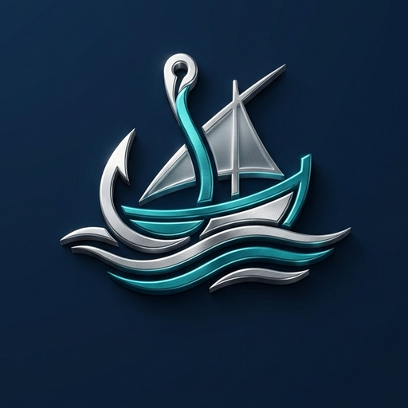
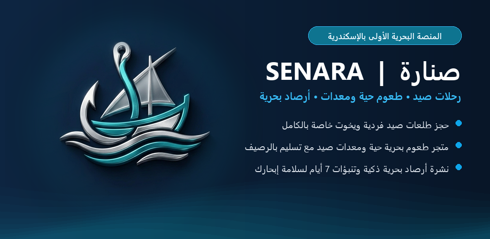

# Hi, I'm Taha Mohamed

Full Stack .NET & Cross-Platform Mobile Engineer based in Alexandria, Egypt. I specialize in designing and building scalable multi-tenant SaaS platforms, high-throughput backend APIs, industrial edge gateway runtimes, and mobile applications with clean architecture and domain-driven design principles.

  
  
  
  
  
  
  

---

## Core Technical Stack

- **Backend & APIs**: C#, .NET 8/10, ASP.NET Core Web API, Minimal APIs, SignalR, Entity Framework Core, LINQ, CQRS, RESTful Architecture.
- **Frontend & Mobile**: Angular 19, TypeScript, RxJS, SCSS, Flutter 3.x, Dart, Material Design.
- **Data & Persistence**: Microsoft SQL Server, SQLite (Edge Caching), Database Migrations, Multi-Tenant Query Filters.
- **Architecture & Security**: Clean Architecture, DDD, ASP.NET Core Identity, JWT Bearer Tokens with Sliding Refresh, HMAC Token Hashing, Role-Based Access Control (RBAC).
- **Edge & IoT Integrations**: Native TCP/IP Sockets (`TcpClient`), Windows Service Background Workers, ESP32 Microcontrollers, Hardware Relay Controllers, UHF RFID Protocols.

---

## Featured Projects

###  [Senara (صِـنَّـارَة) — Marine Booking, Angler Catch Community & Tackle Platform](https://senara.runasp.net)

  

- **Live Platform**: [https://senara.runasp.net](https://senara.runasp.net)
- **Google Play App**: [Senara on Google Play](https://play.google.com/store/apps/details?id=com.senara.app.senara_mobile)
- **Tech Stack**: ASP.NET Core 10 / 9, Clean Architecture, Angular 19, Flutter 3.x, Entity Framework Core, SQL Server, SignalR Hubs, Open-Meteo Marine Weather API, Firebase Cloud Messaging (FCM), JWT Bearer.
- **Overview**: Unified marine booking and angler social ecosystem built for sea anglers, licensed boat captains, and maritime authorities in Egypt. Features dynamic fishing charter scheduling (private charters and shared seat reservations), Egyptian Coast Guard passenger manifest compliance with National ID validation, real-time Open-Meteo sea telemetry (wave heights, swell periods, wind speed, and maritime safety flags), an interactive angler catch bragging community with GPS catch logging, a specialized saltwater tackle e-commerce store, and a captain earnings settlement wallet with double-entry ledger tracking. Source code is private.

### [Eshtry Men Escot (أشتري من اسكوت) — Hyperlocal Delivery & Multi-Vendor Marketplace Platform](https://escot.runasp.net)
- **Live Platform**: [https://escot.runasp.net](https://escot.runasp.net)
- **Tech Stack**: ASP.NET Core 9, Clean Architecture, CQRS (MediatR), SignalR Hubs, Entity Framework Core, SQL Server, Angular 19, Flutter 3.x, Leaflet, JWT Bearer, Double-Entry Financial Ledger.
- **Overview**: Hyperlocal on-demand delivery ecosystem and multi-vendor marketplace tailored for the Escot & Miami Gidida districts in Alexandria, Egypt. Features a triple-application Flutter mobile suite (Customer App, Courier App with live GPS routing and cash settlement, and Merchant Order Dispatch Terminal), an Angular 19 Super Admin operations dashboard with real-time interactive mapping, and a financial engine enforcing strict double-entry ledger settlement, wallet balances, and floating cash controls. Source code is private.

### [FitCoach Pro — Multi-Tenant Fitness & Coaching SaaS Platform](https://github.com/tahayones/fitcoach-pro-showcase)
- **Live Platform**: [https://fitcoachpro.runasp.net](https://fitcoachpro.runasp.net)
- **Google Play App**: [FitCoach Pro on Google Play](https://play.google.com/store/apps/details?id=com.fitcoachpro.mobile)
- **Tech Stack**: ASP.NET Core 10, Clean Architecture, Flutter 3.x, Angular 19, EF Core Multi-Tenancy, SQL Server, Firebase Cloud Messaging (FCM).
- **Overview**: Enterprise-grade SaaS ecosystem for coaches and gyms with automated client onboarding, marketplace, structured workout/nutrition planners, InBody tracking, and cross-platform mobile client. Source code is private.

### [DUVI Delivery Operations Platform](https://github.com/tahayones/duvi-showcase)
- **Tech Stack**: .NET 10, ASP.NET Core Web API, SQL Server, SignalR, JWT, Geofencing, Flutter Client.
- **Overview**: Multi-branch delivery management platform with courier shift scheduling, live order dispatch workflows, geofencing, real-time vehicle tracking via SignalR, and automated operational tests. Source code is private.

### [Pragma POS / Retail ERP Platform](https://github.com/tahayones/pragma-pos-showcase)
- **Tech Stack**: ASP.NET Core Web API, Entity Framework Core, SQL Server, Multi-Tenant Isolation, RBAC Permissions.
- **Overview**: Multi-tenant retail point-of-sale and ERP solution handling inventory lifecycle, sales, returns, purchasing workflows, customer loyalty programs, and detailed financial audit logging. Source code is private.

### [RFID Access Control & Edge Gateway System](https://github.com/tahayones/RfidAccessControl)
- **Tech Stack**: .NET 10 / .NET 8, Clean Architecture, Windows Service Edge Gateway, Native TCP Sockets, SQLite Offline Cache, Angular 19, SignalR.
- **Overview**: Distributed gate and door access management platform connecting UHF RFID readers and relay actuators with an on-premises .NET edge gateway, sub-second access policy evaluation, offline SQLite fallback cache, and an Angular management dashboard. Source code is private.

### [MAKA (HyperMart) — E-Commerce & Retail Supermarket Platform](https://github.com/tahayones/maka-showcase)
- **Tech Stack**: ASP.NET Core 10, Clean Architecture, CQRS, Entity Framework Core, SQL Server, xUnit Tests.
- **Overview**: High-volume retail hypermarket e-commerce system featuring hierarchical category management, point-in-time pricing snapshots, dynamic coupon discounting rules, delivery zone fee calculations, and an order fulfillment state machine. Source code is private.

### [WESAYA — Food & Retail Delivery Operations Platform](https://github.com/tahayones/wesaya-showcase)
- **Tech Stack**: ASP.NET Core 10, Entity Framework Core, SQL Server, Flutter 3.x, Geolocator API, JWT Auth.
- **Overview**: End-to-end delivery operations platform linking restaurant POS and call-center inventory systems with automated courier dispatching, customer GPS geolocation routing, and mobile delivery tracking. Source code is private.

### Smart Tower — IoT Building & Elevator Automation
- **Tech Stack**: ASP.NET Core, Flutter, ESP32 Microcontrollers, WebSocket / MQTT, Industrial Relay Controllers.
- **Overview**: Hardware-integrated IoT platform combining a centralized .NET backend, a Flutter mobile client, and ESP32 microcontroller nodes for building automation and elevator dispatch control.

---

## Current Focus & Availability

I contribute to enterprise web and backend platforms using ASP.NET Core, Angular, Entity Framework Core, SQL Server, and modern DevOps pipelines.

I am open to remote **Full Stack .NET**, **Backend .NET**, and **Cross-Platform Mobile** engineering opportunities.

- **Location**: Alexandria, Egypt
- **Email**: [t.yones134679@gmail.com](mailto:t.yones134679@gmail.com) / [t.mhamed134679@gmail.com](mailto:t.mhamed134679@gmail.com)
- **Contact**: +2001030269169 / +2001500607058

---

  © 2026 Taha Mohamed Awad. All rights reserved.

